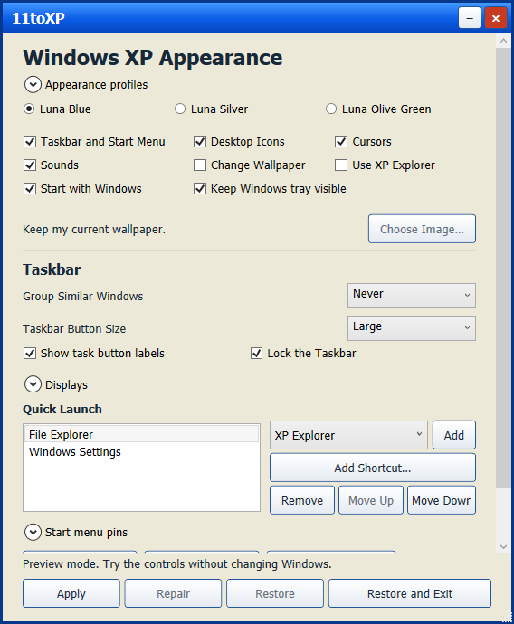
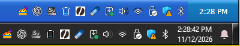

# 11toXP

11toXP gives your Windows 11 desktop the Windows XP Luna look, with an XP-style taskbar, Start menu, and optional file browser. One executable contains the app, its artwork, and the .NET runtime.

**Stable release v0.4.0** for Windows 11 x64.

[Download the portable ZIP](https://github.com/SeanShaffer88/11toXP/releases/download/v0.4.0/11toXP-v0.4.0-win-x64.zip) · [Release notes and SHA-256 checksum](https://github.com/SeanShaffer88/11toXP/releases/tag/v0.4.0)



*The v0.4.0 control window running in preview mode.*



*The XP taskbar during the 15-second layout preview on a single display. The Windows tray below handles clicks.*

## What's new in v0.4.0

- Use **Start Menu Pins** to add and reorder local Windows shortcuts above **All Programs**. Choose **Apply** or **Repair** to preview and save the order.
- With **Keep Windows tray visible** on a single display, live tray icons appear over the Luna background during the countdown and after applying when Windows exposes them. The native tray below handles clicks and menus.
- Right-click a task button for **Restore**, **Minimize**, **Maximize**, or **Close**. For grouped windows, choose the window by title.
- Use **Appearance Profiles** to save, load, or delete named appearance presets. Loading stages the controls for **Apply** or **Repair**. The normal layout countdown applies, and wallpaper and sign-in stay under their own controls.

## Run

Extract the portable ZIP to a folder you plan to keep, then open `11toXP.exe`. The executable is unsigned and includes its runtime. The ZIP also includes `Notices.txt`.

- **Apply** enables the selected appearance components and, by default, starts 11toXP at subsequent sign-ins.
- **Repair** applies changed preferences, refreshes the selected components, and updates the sign-in path if you moved the executable. Turning off a component restores the settings 11toXP still owns for that component.
- **Restore** removes the XP-style taskbar and sign-in entry and restores the settings 11toXP saved. Restore before deleting the executable.
- **Restore and Exit** closes 11toXP after successful restoration. A failed restore leaves the controls open for another attempt.

Choose **Luna Blue**, **Luna Silver**, or **Luna Olive Green**. The taskbar and Start menu, desktop icons, cursors, and sounds each have their own control. The XP taskbar follows the primary display by default. Use **Displays** to choose specific screens. Use **Group Similar Windows** and the Quick Launch list to configure task buttons and the built-in File Explorer, Windows Settings, and XP Explorer shortcuts. The taskbar context menu opens the settings, switches to the Windows taskbar, or opens XP Explorer.

**Open XP Explorer** opens the built-in file browser with a folder tree, task pane, and address bar. It browses local folders and opens files through Windows. **Open in Windows Explorer** opens the displayed folder for native file operations. **Use XP Explorer** routes supported taskbar and Start menu folder shortcuts to the built-in browser.

**Change Wallpaper** starts unchecked. The unchecked default leaves Windows wallpaper untouched through Apply, Repair, Restore, sign-in, and Explorer recovery. To opt in, select a local JPG, PNG, or BMP. Keep the original and replacement files available. Repair requires the original displays. Restore handles connected original displays first, keeps pictures selected independently in Windows, and retries missing displays when reconnected. 11toXP supports static Picture mode and declines unsupported modes it can detect, including slideshow and Windows Spotlight. Uncheck the option and select Repair to restore the saved picture and stop managing it. [Microsoft wallpaper monitor status](https://learn.microsoft.com/en-us/windows/win32/api/shobjidl_core/nf-shobjidl_core-idesktopwallpaper-getmonitorrect)

**Show Windows Taskbar** in the XP Start menu pauses the XP taskbar and restores the Windows taskbar's original auto-hide setting. Select **Repair** to resume the XP taskbar. If Windows ignores the auto-hide request, both bars may be visible. The Windows key still opens the Windows Start menu.

11toXP styles the built-in desktop icons for This PC, Documents, Network, and Recycle Bin if already visible. It uses original assets for those icons and four pointer roles, plus five original sounds for six supported events. High contrast, custom pointer sizes, and muted sound events can limit these changes. Windows Settings, native Explorer, individual app frames, system flyouts, and protected Windows screens retain their native appearance.

## Taskbar and appearance options

- **Taskbar Button Size** switches between Large and Small. Clear **Show task button labels** for an icon-only view with accessible names. Clear **Lock the Taskbar** to resize by dragging the top grip or using the Up and Down arrow keys while the grip has focus.
- **Displays** follows the primary display by default. Clear **Follow the primary display** to choose which connected displays get an XP bar. Selected displays remain saved when disconnected. Windows manages its native taskbars when multiple displays are connected.
- **Apply** or **Repair** previews changes to the XP taskbar for 15 seconds. Choose **Keep** to save the layout and apply your other selected settings. Choose **Undo**, press Esc, close the dialog, or let the timer expire to return to the previous layout. A resize from the grip saves only the taskbar size.
- **Keep Windows tray visible** is checked by default, including for older preferences. On a single display, 11toXP mirrors live notification icons beside the XP clock during the 15-second preview and after applying when Windows exposes the tray. Use the native Windows tray below the XP bar for clicks and menus. Undo or timeout restores the tray state from before the preview. For the XP-only layout, uncheck the option and select **Repair**. **Restore** returns the original Windows auto-hide setting.
- In XP-only mode, select **Show Windows Tray** beside the clock to temporarily reveal the Windows tray below the XP bar. Select **Hide Windows Tray** to return to XP-only mode. The temporary reveal ends when you repair, restore, or restart 11toXP.
- **Start with Windows** defaults to on, including when an older recovery journal has no startup preference. Uncheck it and choose **Apply** or **Repair** to use the theme for the current Windows session. 11toXP removes its sign-in entry and attempts to restore your original settings at sign-out. If restoration was interrupted, reopening 11toXP retries it. Use **Restore and Exit** for immediate cleanup.
- **Add Shortcut** adds a local Windows shortcut (`.lnk`) to Quick Launch. Move or remove it with the same controls used for built-in entries. 11toXP keeps the original shortcut file in place and asks Windows to open it when you click its Quick Launch button.
- **Export Diagnostics** creates a new JSON file at a location you choose. It refuses existing destinations and files in the 11toXP settings folder. It records the Windows build, the control window’s display scale, the component flags configured in the active recovery journal, and the category and type of the most recent recovery error in the session, if any. The report excludes private paths, filenames, and usernames. 11toXP collects no telemetry.

## State And Recovery

11toXP records original settings and active preferences in `%LOCALAPPDATA%\11toXP\theme-state.json` before applying changes. It also stores control and browser window placement and local copies of generated appearance assets. Sign-in uses the app-owned `11toXP.0348C6BA` value under `HKCU\Software\Microsoft\Windows\CurrentVersion\Run`. Reopen 11toXP and select **Restore** after an interrupted operation. If no instance is running, `11toXP.exe --restore` can perform the same recovery. A running instance returns exit code 3 for this command and can restore through its window.

11toXP retains saved non-wallpaper preferences in `%LOCALAPPDATA%\11toXP\preferences.json` after **Restore**. Named appearance profiles are stored separately in `appearance-profiles.json` in the same folder.

After a forced interruption, the native taskbar can stay behind the desktop even after 11toXP restores its saved settings. This also occurred with v0.3.0 on the test desktop. If the native taskbar remains inaccessible after restoring, press **Ctrl+Shift+Esc**, select **Windows Explorer** in Task Manager, and choose **Restart**. This restored the tray on the test desktop.

If you use the XP-only layout, an OS build change may leave both taskbars visible until **Repair** verifies auto-hide on the new build. The app uses Windows taskbar APIs and per-user settings. It makes no network requests. The bundled runtime can extract native libraries to the .NET temporary bundle cache at launch.

## Build And Verify

Use the .NET 10 SDK on Windows. The x64 bundle requires Windows 11 and no separate runtime installation. Run the following from the source directory in PowerShell.

```powershell
dotnet publish LunaDesktop.csproj -c Release -r win-x64 --self-contained true -o .\bin\bundle -p:PublishSingleFile=true -p:IncludeNativeLibrariesForSelfExtract=true -p:EnableCompressionInSingleFile=true -p:DebugType=None -warnaserror
if ($LASTEXITCODE -ne 0) { exit $LASTEXITCODE }
$check = Start-Process .\bin\bundle\11toXP.exe -ArgumentList '--self-test' -PassThru -Wait
if ($check.ExitCode -ne 0) { exit $check.ExitCode }
```

`--self-test` uses an isolated temporary journal and a simulated Windows settings adapter. It checks wallpaper opt-in and opt-out, rollback, retry, per-component transitions, legacy journals, Explorer and sign-in recovery, startup collisions and moves, taskbar compatibility decisions, Start menu pin order, and profile persistence. `--preview` opens the controls with simulated theme actions for UI inspection. Live shell behavior requires an interactive Windows 11 desktop.

Live checks on Windows 11 x64 covered Start menu pin order and launch, profile persistence and staging, tray mirroring before and after **Keep**, layout rollback, and window commands for single and grouped taskbar buttons. The v0.4.0 checks confirmed that wallpaper stays unchanged with **Change Wallpaper** off. Applying a selected picture, opting out, and restoring the original picture were verified on v0.3.0. Live sign-out and sign-in and mixed-DPI display transitions were skipped.

Project source uses the MIT license. The self-contained executable redistributes the .NET Windows Desktop runtime under its own license and notices. [Microsoft runtime licensing](https://github.com/dotnet/core/blob/main/license-information-windows.md)
